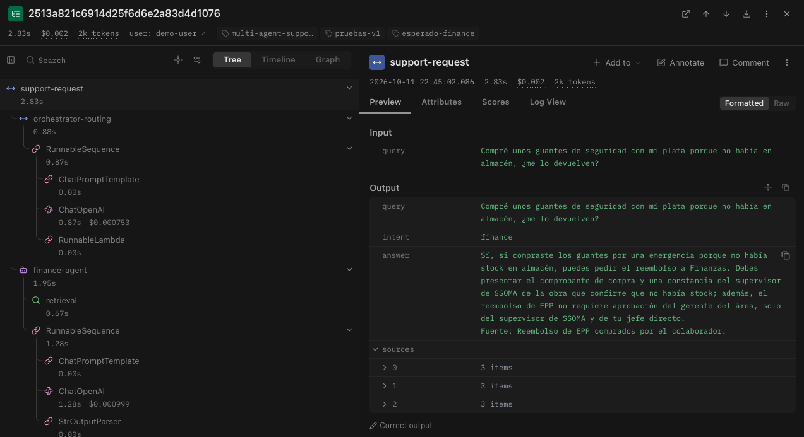

# Sistema multiagente de soporte interno — Andina Obras S.A.C.

Proyecto Integrador del **Módulo 3 — AI Engineering (Henry)**.

Sistema de enrutamiento inteligente de consultas internas: un **agente orquestador** clasifica la intención de la consulta de un colaborador y la delega al **agente RAG especializado** del área correspondiente (Recursos Humanos, Mesa de Ayuda de TI o Finanzas), que responde usando únicamente la documentación interna de esa área y cita la fuente. Todo el flujo está implementado con **LangChain** y trazado de punta a punta con **Langfuse**.

**Resultado:** 17/17 consultas de prueba enrutadas correctamente (100%), incluidas consultas ambiguas, informales y fuera de alcance.

---

## Contexto

La consigna plantea una empresa SaaS cuyo equipo de soporte recibe consultas mal enrutadas entre áreas. Este proyecto adapta el escenario a **Andina Obras S.A.C.**, una constructora peruana ficticia (~250 colaboradores entre oficina y obra), porque sus áreas tienen vocabularios más diferenciados y generan casos borde más realistas (por ejemplo, un EPP comprado con dinero propio parece un tema de RR. HH. pero lo reembolsa Finanzas). La arquitectura es la misma que pide la consigna.

> Andina Obras y todas sus políticas son ficticias, creadas con fines de formación. No constituyen asesoría legal ni laboral.

---

## Arquitectura

```
Consulta del usuario
        │
        ▼
  Orquestador (LLM + salida estructurada)
        │  intent: hr | tech | finance | out_of_scope
        │
        ├─► Agente HR       ── RAG sobre la colección hr_docs
        ├─► Agente Tech     ── RAG sobre la colección tech_docs
        ├─► Agente Finance  ── RAG sobre la colección finance_docs
        └─► out_of_scope    ── mensaje fijo, sin llamar a ningún agente
        │
        ▼
  Respuesta con fuentes  ──►  Trace completo en Langfuse
```

**Flujo de cada consulta**

1. El **orquestador** clasifica la consulta y devuelve un objeto `RoutingDecision` (intent, confianza y justificación) validado con Pydantic.
2. El **enrutamiento condicional** busca el agente correspondiente en un diccionario `intent -> agente`.
3. El **agente RAG** recupera los 3 chunks más similares de **su propia colección** en Chroma, arma el contexto con la procedencia de cada chunk y genera la respuesta citando la sección usada.
4. Cada paso queda registrado en **Langfuse** como parte de un único trace.

---

## Stack

| Componente | Tecnología |
|---|---|
| Orquestación | LangChain 1.x (LCEL, `with_structured_output`) |
| LLM | OpenAI `gpt-5.4-mini` |
| Embeddings | OpenAI `text-embedding-3-small` |
| Vector store | Chroma (persistido en disco, una colección por dominio, similitud coseno) |
| Observabilidad | Langfuse v4 (spans + `CallbackHandler` de LangChain) |
| Validación de datos | Pydantic v2 |
| Lenguaje | Python 3.10+ (desarrollado con 3.14) |

---

## Estructura del proyecto

```
multi-agent-support/
├── data/
│   ├── hr_docs/              # 5 documentos .md — 54 chunks
│   ├── tech_docs/            # 5 documentos .md — 54 chunks
│   └── finance_docs/         # 5 documentos .md — 55 chunks
├── prompts/
│   ├── orchestrator_system.txt   # reglas de clasificación del orquestador
│   └── rag_agent_system.txt      # instrucciones compartidas por los agentes
├── src/
│   ├── config.py             # configuración central y validación de claves
│   ├── schemas.py            # contratos Pydantic (RoutingDecision, AgentResponse...)
│   ├── ingest.py             # pipeline de ingesta: .md -> chunks -> Chroma
│   ├── vectorstore.py        # acceso único a las colecciones de Chroma
│   ├── tracing.py            # cliente de Langfuse y CallbackHandler
│   ├── multi_agent_system.py # punto de entrada: orquestador -> agente -> respuesta
│   ├── evaluate_routing.py   # evaluación rápida del orquestador con test_queries.json
│   └── agents/
│       ├── orchestrator.py   # clasificación de intención
│       ├── rag_agent.py      # clase RAGAgent genérica (retrieval + generación)
│       ├── hr_agent.py       # instancia de RAGAgent para RR. HH.
│       ├── tech_agent.py     # instancia de RAGAgent para TI
│       └── finance_agent.py  # instancia de RAGAgent para Finanzas
├── docs/
│   └── langfuse_trace.png    # captura de un trace
├── multi_agent_system.ipynb  # notebook de demostración (6 secciones)
├── test_queries.json         # 17 consultas de prueba con su intención esperada
├── requirements.txt
└── .env.example
```

---

## Instalación

**Requisitos:** Python 3.10 o superior, una API key de OpenAI y una cuenta gratuita de [Langfuse Cloud](https://cloud.langfuse.com).

```bash
# 1. Clonar el repositorio
git clone https://github.com/JCesarAguilar/multi-agent-support.git
cd multi-agent-support

# 2. Crear y activar el entorno virtual
python3 -m venv .venv
source .venv/bin/activate        # en Windows: .venv\Scripts\activate

# 3. Instalar dependencias (versiones fijadas)
pip install -r requirements.txt

# 4. Configurar las claves
cp .env.example .env
```

Editar `.env` con tus claves:

| Variable | Dónde se obtiene |
|---|---|
| `OPENAI_API_KEY` | platform.openai.com → API keys |
| `LANGFUSE_PUBLIC_KEY` / `LANGFUSE_SECRET_KEY` | Langfuse → proyecto → Settings → API Keys |
| `LANGFUSE_HOST` | `https://cloud.langfuse.com` (EU) o `https://us.cloud.langfuse.com` (US), según la región de la cuenta |

Opcionalmente se puede definir `LLM_MODEL` y `EMBEDDING_MODEL` en el `.env` para cambiar de modelo sin tocar código.

---

## Uso

### 1. Construir los índices (una sola vez)

```bash
python -m src.ingest            # genera embeddings y crea las 3 colecciones en chroma_db/
python -m src.ingest --dry-run  # opcional: muestra los chunks sin llamar a OpenAI
```

La ingesta es idempotente: se puede volver a ejecutar sin duplicar chunks.

### 2. Hacer una consulta desde la terminal

```bash
python -m src.multi_agent_system "Compré unos guantes con mi plata, ¿me lo devuelven?"
```

```
Consulta : Compré unos guantes con mi plata, ¿me lo devuelven?
Área     : finance
Respuesta: Sí, si compraste unos guantes por una emergencia y no había stock en almacén,
           puedes pedir el reembolso a Finanzas. Debes presentar el comprobante de compra
           y una constancia del supervisor de SSOMA de la obra...
           Fuente: Reembolso de EPP comprados por el colaborador.
  - reembolsos_y_gastos.md > Reembolso de EPP comprados por el colaborador (0.464)
  - reembolsos_y_gastos.md > Reembolsos observados o rechazados (0.412)
  - reembolsos_y_gastos.md > Comprobantes válidos (0.408)
```

### 3. Notebook de demostración

Abrir `multi_agent_system.ipynb`, seleccionar el kernel del `.venv` y ejecutar **todas las celdas en orden** (Reiniciar → Ejecutar todo). Requiere haber corrido antes la ingesta. Secciones:

1. Setup e imports (verifica las claves y la conexión con Langfuse)
2. Documentos y vector stores (verifica ≥ 50 chunks por dominio)
3. Definición de agentes (cada agente probado por separado + fallo seguro)
4. Orquestador y enrutamiento condicional
5. Pruebas y ejemplos (las 17 consultas por el sistema completo)
6. Integración con Langfuse

### 4. Evaluar solo el orquestador

```bash
python -m src.evaluate_routing
```

Prueba rápida y barata del clasificador con las 17 consultas, útil después de modificar `prompts/orchestrator_system.txt`.

---

## Resultados

Las 17 consultas de `test_queries.json` cubren los tres agentes y cinco categorías de dificultad:

| Categoría | Ejemplo | Aciertos |
|---|---|---|
| directa | "¿Cuántos días de licencia por paternidad me corresponden?" | 6/6 |
| informal | "oye cuando me cae la grati de julio??" | 2/2 |
| ambigua | "Me depositaron menos de lo normal este mes" (parece Finanzas, es RR. HH.) | 6/6 |
| fuera de alcance | "¿Cómo calculo el volumen de concreto para una losa?" | 2/2 |
| multi-intención | "Quiero pedir vacaciones y además mi laptop no prende" | 1/1 |
| **Total** | | **17/17 (100%)** |

El resultado se repitió en ejecuciones independientes (clasificación determinista, ver decisiones técnicas).

**Operación medida en Langfuse**

| Métrica | Valor aproximado |
|---|---|
| Latencia por consulta | ~2.5–3 s (consulta respondida por un agente) |
| Latencia fuera de alcance | ~1 s (no se llama a ningún agente) |
| Costo por consulta | ~US$ 0.002 (≈ US$ 2 por cada 1.000 consultas) |
| Tokens por consulta | ~2.000 |

---

## Observabilidad con Langfuse

Cada consulta genera un trace con esta estructura:

```
support-request              (trace: consulta y respuesta final)
├── orchestrator-routing     (span: intent, confidence, reasoning)
│   └── ChatOpenAI           (generation: prompt, respuesta, tokens, costo)
└── <intent>-agent           (agent: hr-agent / tech-agent / finance-agent)
    ├── retrieval            (retriever: chunks recuperados con su score)
    └── ChatOpenAI           (generation)
```



Con esta estructura se puede diagnosticar dónde falla una consulta:

- **Clasificación errónea:** el output de `orchestrator-routing` muestra el intent elegido y su justificación.
- **Retrieval deficiente:** el span `retrieval` muestra qué chunks se recuperaron y con qué score.
- **Respuesta incorrecta con buen contexto:** la generation del agente muestra el prompt exacto que recibió el modelo.

Cada trace lleva `user_id`, `session_id` y tags. Las consultas de prueba del notebook se etiquetan con `pruebas-v1` y `esperado-<intent>`, lo que permite filtrar una corrida completa y comparar versiones.

---

## Decisiones técnicas

**1. Un vector store por dominio.** Cada agente busca solo en su colección de Chroma. Así un chunk de Finanzas nunca contamina la respuesta de RR. HH., y cada base de conocimiento se puede actualizar por separado. Se clasifica la intención *antes* de recuperar porque una clasificación es barata y evita buscar en tres índices a la vez.

**2. Chunking por sección del Markdown.** Los documentos se dividen por títulos `##` con `MarkdownHeaderTextSplitter`, y un `RecursiveCharacterTextSplitter` (1.200 caracteres, solapamiento de 150) actúa como red de seguridad para secciones largas. Cada sección es un tema autocontenido, lo que evita chunks que mezclan el final de un tema con el inicio de otro.

**3. Contextual chunk header.** Antes de generar el embedding, a cada chunk se le antepone el título del documento y el nombre de la sección, para que el vector capture de qué trata el fragmento aunque el párrafo no lo repita. Cada chunk guarda además metadata de procedencia (`domain`, `source`, `section`, `chunk_id`) para citar la fuente.

**4. Ingesta idempotente.** Los IDs de los chunks son deterministas y la colección se reconstruye en cada ingesta, por lo que re-ejecutarla no duplica datos.

**5. `TOP_K = 3`, decidido con datos.** En la consulta "Me depositaron menos de lo normal este mes", la sección correcta ("Errores o diferencias en la boleta") quedó en tercer lugar, detrás de "CTS" y "Gratificaciones", que también hablan de depósitos. Con `TOP_K = 2` se habría perdido; con 3, el LLM la recibe y la usa.

**6. Orquestador con salida estructurada.** `with_structured_output(RoutingDecision)` obliga al LLM a devolver un objeto validado por Pydantic. El intent es un `Literal["hr", "tech", "finance", "out_of_scope"]`, así que un valor fuera de esa lista es imposible. La regla se impone en el código, no solo en el prompt. Un chequeo al importar `schemas.py` verifica que el `Literal` coincida con los dominios de `config.py`.

**7. Reglas explícitas en el prompt del orquestador.** El prompt clasifica según el **área dueña del tema** y no según palabras sueltas, con reglas para las fronteras entre áreas (por ejemplo: si una aplicación no funciona es TI; si funciona pero el dato es incorrecto, es del área dueña del dato). Los ejemplos few-shot del prompt **no** coinciden con las consultas de prueba, para evitar fuga de datos (data leakage).

**8. Categoría `out_of_scope` sin llamada al agente.** Las consultas que ninguna área debe responder reciben un mensaje fijo. Esto evita respuestas inventadas y además es ~3 veces más rápido y barato.

**9. Clasificación determinista.** En los modelos `gpt-5.x`, LangChain descarta `temperature=0` en silencio salvo que se use `reasoning_effort="none"`. Se configuran ambos, lo que hace la clasificación reproducible y más rápida (clasificar en 4 categorías no requiere razonamiento extendido).

**10. Agente RAG genérico.** La lógica RAG vive en una sola clase (`RAGAgent`); `hr_agent.py`, `tech_agent.py` y `finance_agent.py` son instancias con su dominio y rol. Se respeta la estructura de archivos de la consigna sin duplicar código. Agregar un dominio nuevo requiere sus documentos, una línea en `config.py`, su descripción en el prompt del orquestador y una instancia de `RAGAgent`.

**11. Fallo seguro (grounding).** El prompt de los agentes exige responder solo con la documentación y decir explícitamente cuando no encuentra la información. Los documentos indican qué temas pertenecen a otras áreas, de modo que si una consulta llega al agente equivocado, este deriva al área correcta en vez de inventar.

**12. APIs actuales en lugar de las del curso.** El material del curso usa la API clásica de LangChain (`RetrievalQA`, `initialize_agent`) y la API v2 de Langfuse (`langfuse.trace()`). Este proyecto usa **LangChain 1.x con LCEL** y **Langfuse v4** (`start_as_current_observation`, `propagate_attributes`), que son las versiones vigentes. Los conceptos (Trace, Span, Generation) son los mismos.

**13. Configuración fail-fast.** `config.validate_config()` verifica al inicio que las claves existan y no tengan valores de ejemplo, en vez de fallar después con un error 401 poco claro. `LANGFUSE_HOST` (pedido por la consigna) se pasa explícitamente como `base_url`, el nombre vigente en Langfuse v4.

---

## Limitaciones conocidas

- **Dataset de prueba pequeño.** 17 consultas permiten detectar errores, pero un 100% no garantiza ese resultado en producción. Además, las consultas y las reglas del prompt fueron escritas por la misma persona; en un caso real convendría probar con tickets reales nunca vistos.
- **La confianza del orquestador no está calibrada.** El valor `confidence` se mantuvo entre 0.93 y 0.99 en todas las consultas, incluidas las ambiguas, así que no se usa para tomar decisiones.
- **Una sola intención por consulta.** Si una consulta mezcla dos temas, el sistema elige el más urgente y responde solo ese.
- **Consultas que cruzan dominios.** Ejemplo: "La app de Andina360 no me deja marcar mi asistencia" se enruta bien a TI, pero el procedimiento completo (regularizar la asistencia con RR. HH.) está en los documentos de RR. HH., así que la respuesta queda incompleta. Un ruteo correcto no garantiza una respuesta completa.
- **El LLM complementa con conocimiento propio.** Ante "¿Cuánto es el viático si viajo a Arequipa?", el modelo dedujo que Arequipa es capital de departamento, un dato que no está en los documentos (en este caso, correcto). El grounding reduce las alucinaciones, pero no las elimina.
- **Latencia de la primera consulta.** La primera llamada del proceso tarda más (~2.2 s solo en el orquestador frente a ~0.9 s en llamadas posteriores) por la apertura de la conexión con la API.

## Mejoras futuras

- Agente evaluador que puntúe cada respuesta (1–10) con la Score API de Langfuse, para medir la calidad de las respuestas además del ruteo.
- Delegación a dos agentes en paralelo para consultas multi-intención o que cruzan dominios.
- Búsqueda híbrida (BM25 + semántica) o reranking para mejorar el orden del retrieval.
- Ampliar el dataset de prueba con consultas reales y correrlo automáticamente en cada cambio (CI).

---

## Autor

**Julio César Aguilar** — Proyecto Integrador M3, AI Engineering (Henry), 2026.
